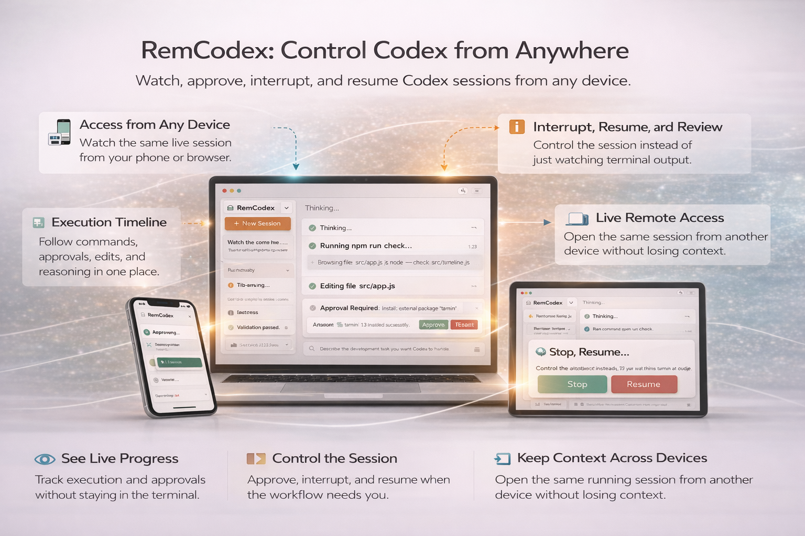
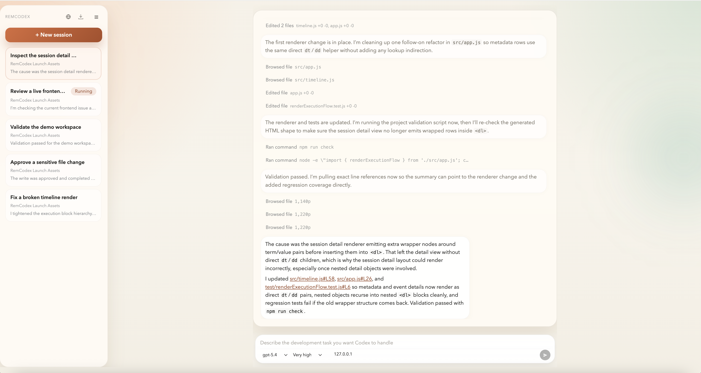
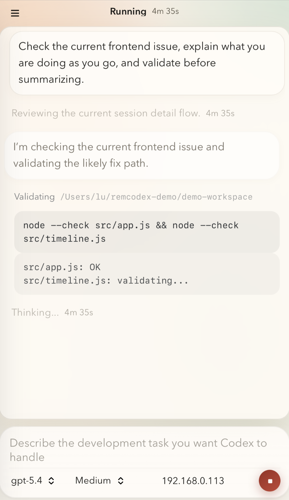
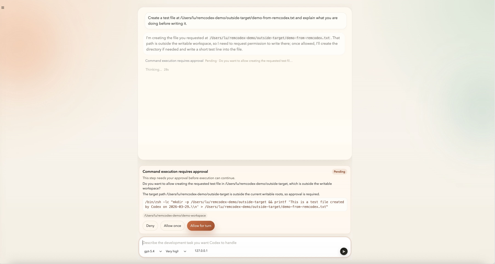
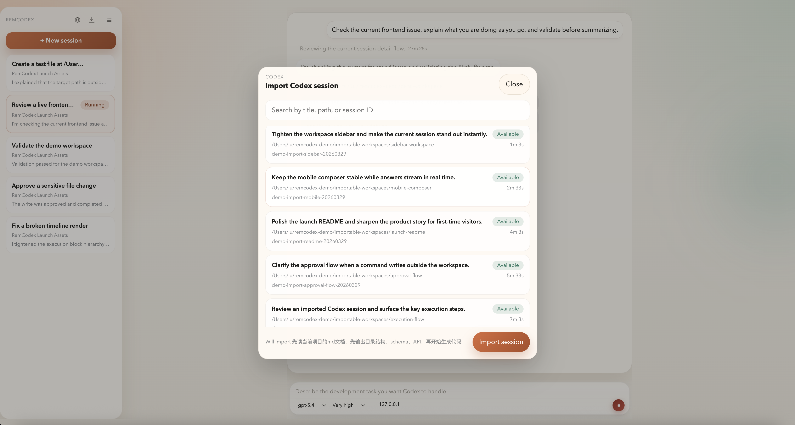

# 🚀 RemCodex

> Remote control for Codex.  
> From your browser and phone.

Run Codex on one machine.  
Monitor, approve, and control the same session from another.

🌐 https://remcodex.com

> Not a remote desktop. Not a proxy.  
> A local-first way to control Codex away from the terminal.



---

## ✨ What is RemCodex?

RemCodex is **remote control for Codex**.

It lets you start Codex on one machine, then keep the same session visible,
interruptible, and controllable from another.

- 👀 See what the AI is doing — in real time
- ✅ Approve or reject actions before execution
- ⏹ Interrupt or stop at any moment
- 📱 Access your session from any device
- 🔄 Sessions don’t break — they resume

> One session. Any device.

---

## 🎬 A real workflow

You start a long Codex session on your machine.

Then you leave your desk.

On your phone:

- you see progress in real time
- you receive an approval request
- you approve it

The session continues instantly.

> Everything else can disconnect — your session won’t.

---

## 🔥 Why RemCodex exists

AI coding agents are powerful.  
But today, they run like a black box.

You either:

- trust everything blindly
- or sit in front of your terminal watching it

RemCodex fixes that.

> AI is no longer a black box.

---

## ⚡ What it does

- Real-time execution timeline (messages, commands, approvals)
- Human-in-the-loop command approval
- Multi-device access to the same live session
- Resume after refresh, sleep, or reconnect
- Voice-note prompt capture with local transcription
- Browser-based UI — **no extra client required**
- Optional Android mobile shell in [`mobile/`](mobile/)
- Works with Codex CLI

> No extra client install. Just open a browser.  
> Your code never leaves your machine.

---

## 🚀 Quick start

```bash
npx remcodex
```

Then open:

http://127.0.0.1:18840

To connect from a phone or another device, explicitly enable authenticated LAN access:

```bash
REMCODEX_HOST=0.0.0.0 REMCODEX_API_TOKEN="<long-random-secret>" npx remcodex
```

Open `http://<your-ip>:18840` and enter the token. Without these settings,
RemCodex listens on localhost only. Use HTTPS through a reverse proxy when
accessing it over untrusted networks.

> Runs entirely on your local machine. No cloud, no data upload.

### RemCodex directory

RemCodex can also serve a directory page that links to multiple RemCodex
instances. Configure the instances as a JSON array at startup:

```bash
export REMCODEX_DIRECTORY_INSTANCES='[
  {"name":"Home","url":"https://remcodex.example","description":"Primary workspace"},
  {"name":"Lab","url":"https://lab-remcodex.example"}
]'
npx remcodex
```

Then open `/directory` on the RemCodex host. Each configured instance is
validated and displayed as an openable card.

Nix users can run the packaged server directly:

```bash
nix run .#
```

---

## 🖥 Screenshots



> Run and review Codex sessions in a single-page workspace.



> Follow a live Codex session from your phone.



> Approve sensitive file-system actions from the UI.



> Bring imported Codex rollouts into the same workspace.

---

## 🧠 What it actually is

RemCodex is a **browser-based workspace for Codex sessions**.

It is built for real workflows:

- long-running sessions
- mobile check-ins
- approval prompts
- imported rollout history
- discoverable Codex app-server sessions
- timeline-style execution flow

Instead of raw terminal logs, you get a structured, visual timeline you can follow and control.

### Interactive Codex app-servers

When configured by Panoply, a bare interactive `codex` command starts a Unix-socket
app-server and records its endpoint under `$XDG_RUNTIME_DIR/codex-app-servers`.
RemCodex discovers those endpoints, imports their thread history, and can send
follow-up turns through the same app-server. Remote follow-up turns retain `on-request` approvals and default to a
`workspace-write` sandbox; MCP tools are not automatically approved. Live TUI
control is experimental and disabled unless `REMCODEX_ENABLE_TUI_CONTROL=1` is
set. Discovery/history viewing remains available without enabling execution. Explicit Codex subcommands continue to pass directly to the underlying
CLI.

The workspace sidebar's `+ New session` control also remembers a default
profile. Pick `Custom` to keep the current project-selection flow, or choose one
of the defined profiles to reuse it for future UI-started sessions.
When a profile provides a starting prompt, RemCodex shows it above the composer
as a temporary banner and prepends it to the first message you send in that
session.

---

## 🧩 Current product shape

- Single-page workspace UI
- Left sidebar for session navigation
- Right-side execution timeline
- Fixed input composer
- Optional voice-note capture button under send
- Semantic timeline rendering for:
    - user messages
    - assistant output
    - thinking
    - commands
    - patches
    - approvals
    - system events

---

## ⚙️ Key behaviors

### Approvals

- Writes inside working area → auto allowed
- Writes outside → require approval
- `Allow once` / `Allow for this turn` supported
- Approval history stays visible in timeline

---

### Timeline

- Semantic rendering (not raw logs)
- Commands grouped into readable activity blocks
- Running / failed states clearly visible
- Smooth streaming + recovery after refresh

---

### Imported sessions

- Import from `~/.codex/sessions/...`
- Keep syncing if still active
- Unified view with native sessions

---

## 🧠 Architecture

```
Codex CLI → Event stream → Semantic layer → Timeline → Web UI
```

---

## ⚙️ Requirements

- Node.js
- Codex CLI (already working locally)

---

## ⚙️ Configuration

Default port: **18840**

```bash
PORT=18841 npx remcodex
```

If RemCodex is reached through a hostname or reverse proxy, set
`REMCODEX_HOSTNAME` to the public hostname or full HTTP(S) origin. Session
links returned by the API and MCP tools will use that value; when it is not
set, they remain relative links:

```bash
REMCODEX_HOSTNAME=https://remcodex.example.com npx remcodex
```

The MCP endpoint lives at `POST /mcp`. If `REMCODEX_MCP_API_TOKEN` is set at
startup, the server will require the matching bearer token on every MCP
request. If it is not set, MCP stays disabled and the rest of RemCodex still
starts normally:

```bash
REMCODEX_MCP_API_TOKEN=secret npx remcodex
```

Clients must send:

```bash
Authorization: Bearer secret
```

To register RemCodex itself as a Codex MCP server, add this to
`~/.codex/config.toml` and adjust the port or token path if needed:

```toml
[mcp_servers.remcodex]
url = "http://127.0.0.1:18840/mcp"
default_tools_approval_mode = "approve"

[mcp_servers.remcodex.http_headers]
Authorization = "Bearer $(cat /path/to/remcodex-token)"
```

If you do not set `REMCODEX_MCP_API_TOKEN` when starting RemCodex, leave the
`http_headers` table out.

### Interactive TUI wrapper

`remcodex-tui` is a Python wrapper around the Codex CLI. With no arguments it
starts a local Unix-socket Codex app-server, registers it for RemCodex
discovery, and launches the interactive TUI through `codex --remote`. Explicit
Codex arguments pass through unchanged, so commands such as
`remcodex-tui exec --help` retain normal Codex behavior.

The wrapper honors `CODEX_COMMAND`, `XDG_RUNTIME_DIR`, and
`CODEX_APP_SERVER_REGISTRY_DIR`.

The MCP `create-session` tool accepts either a `projectId` or a
`workingDirectory`. Directory requests resolve an existing project and reuse
the latest non-terminal session for that directory; if the directory is not
registered yet, RemCodex registers it as a project before creating the session.
Providing `parentSessionId` always creates a new child session instead of
reusing an existing one.

### Per-turn MCP tool policy

REST message requests and the MCP `send-message` tool may include structured
`codex.allowedTools` and `codex.deniedTools` arrays. Each selector is an object with a required
`server` name and an optional `tool` name. A selector without `tool` applies to
the whole MCP server; a selector with `tool` applies only to that tool:

```json
{
  "codex": {
    "allowedTools": [{ "server": "vikunja" }],
    "deniedTools": [{ "server": "rhizomatic_server", "tool": "delete_themagraph" }]
  }
}
```

RemCodex validates selector names, rejects duplicates and any allow/deny
overlap (including a server selector overlapping a tool selector), and emits
only its internal allowlisted `mcp_servers.<server>[.tools.<tool>].enabled`
Codex configuration keys. Raw Codex configuration objects are not accepted.
When no policy is supplied, the existing Codex configuration is unchanged.

### Named remote MCP targets

MCP tool calls may target a named configured RemCodex instance by adding
`instanceName` to the tool arguments. Configure targets with
`REMCODEX_REMOTE_INSTANCES`; the `credentialRef` is an environment-variable
name resolved only by the RemCodex server and is never accepted from the
caller:

```bash
export REMCODEX_REMOTE_INSTANCES='[
  {"name":"home","url":"https://remcodex.example","credentialRef":"REMCODEX_HOME_TOKEN"}
]'
export REMCODEX_HOME_TOKEN='server-side-token'
```

Targets must use HTTPS, cannot contain URL credentials, and reject loopback or
private hosts. Unknown targets, missing credentials, and malformed
configurations fail closed. A routed request uses only the selected target's
credential; the caller's bearer token is not forwarded. Omitting `instanceName`
preserves the local/default MCP behavior.

### Peer capability safety defaults

The peer-communication service uses separate administrator and worker
credentials, deny-by-default named scopes, directed grants bound to source,
target, and work-package identities, append-only audit records, and hashed
server-issued credential tokens. Message payloads are capped at 16 KiB, reads
at 100 messages, timelines at 100 entries, summaries at 8 KiB, and retained
messages at 1,000 per grant. Credentials lease for 15 minutes unless a caller
of the service supplies a shorter bound; expiry and explicit dormancy are
audited and do not reactivate the old credential.

### Internal Orchestrator digest delivery

Coordination digests use contract version `1` and address the local
`local-orchestrator` recipient. RemCodex delivers them to a durable internal
SQLite queue; it does not open a public digest endpoint or make an outbound
network request. The default and currently supported mode is
`REMCODEX_ORCHESTRATOR_DIGEST_MODE=internal` (omitting the variable has the
same behavior); unsupported modes fail closed at startup.

Each digest has a stable `digestId`, bounded entries, and a 4 KiB serialized
size limit. The existing authenticated MCP transport exposes
`peer-read-orchestrator-digests` and
`peer-acknowledge-orchestrator-digest` to an administrator credential carrying
`admin.peer.digest`. Delivery is insert-idempotent by `digestId`; an
acknowledgement is durable and repeatable. A scheduler delivery failure leaves
the batch queued for the next cadence, while concurrent flushes are
serialized. Worker credentials cannot read or acknowledge the queue.

The read-only `list-sessions-by-directory` tool returns all sessions recorded
for a working directory, including completed and failed sessions.

The `resume-session` tool selects an existing session for continued work. It
can optionally associate the resumed session with a parent session and changes
terminal session status back to `idle` so the next message can continue it.
Parenting follows the directory tree: a parent session's project directory
must contain the child session's project directory.

RemCodex can seed agent profiles from a static TOML config at startup. By
default it reads `~/.remcodex/config.toml`, and you can override that with
`REMCODEX_CONFIG_PATH`.

The sample file at `docs/remcodex-profiles.example.toml` shows the supported
shape:

```toml
[[profiles]]
name = "remcodex-demo"
starting_prompt = "Use RemCodex to inspect the current session, keep the workspace state in view, and prefer small safe changes when testing UI flows."
default_directory = "/home/evak/programming/by_category/agentic/remcodex"
```

The profile API still exists for runtime additions, but startup config is the
preferred way to define the profiles that appear in the new-session dropdown.
The profile `starting_prompt` becomes a one-time prefix for the first message in
the session, and the UI banner disappears after that message is sent.

The flake default package wraps `remcodex` with:

- Node.js 20
- `whisper-ctranslate2`
- `ffmpeg`
- a bundled tiny English Whisper model exposed through `REMCODEX_STT_MODEL_PATH`

Examples:

```bash
nix build .#
./result/bin/remcodex doctor
./result/bin/remcodex stt-self-test

nix develop
remcodex start
```

For the Web UI reply-drop investigation harness, the flake also exposes a Linux check that:

- boots RemCodex in a local OCI container
- swaps real Codex calls for a deterministic mock `app-server`
- streams assistant replies through cumulative `item/updated` events
- drives repeated chat submissions through Playwright until a reply goes missing or the loop completes

Run it with:

```bash
nix build .#checks.x86_64-linux.remcodex-debug-output
```

The package also includes a smoke test for the MCP auth gate:

```bash
npm run smoke:mcp-auth
```

Voice-note transcription is optional and stays local. RemCodex will look for a whisper CLI on the server machine in this order:

- `whisper`
- `whisper.cpp`
- `whisper-ctranslate2`

You can override that detection with:

```bash
REMCODEX_STT_BINARY=/path/to/whisper \
REMCODEX_STT_MODEL_PATH=/path/to/model \
npx remcodex
```

When voice transcription is available, the composer shows a microphone button below send. Click once to record, click again to stop, transcribe, and submit the transcript as a normal user prompt in the timeline.

To validate the local transcription wiring without opening the browser:

```bash
remcodex stt-self-test
```

---

## 📦 Install FAQ

### Why does `npx remcodex` hang on Linux?

First install may compile native deps:

- `better-sqlite3`
- `node-pty`

Make sure you have:

- `python3`
- `make`
- `g++`

---

### Debug install issues

```bash
npm install -g remcodex
remcodex doctor
remcodex start
```

---

### Headless mode

```bash
npx remcodex --no-open
```

---

## 🔧 How it works

1. Codex emits events
2. Backend stores them (SQLite)
3. Frontend loads timeline snapshot
4. Live updates stream via WebSocket

Result:

- recoverable sessions
- real-time UI
- consistent execution flow

---

## 📊 Status

- Beta / developer preview
- Local-first architecture
- No cloud dependency

---

## 🗺 Roadmap

**Visibility**

- fully observable execution
- clear action timeline

**Control**

- fine-grained approvals
- safer execution

**Continuity**

- survive refresh / sleep
- stable long runs

**Access**

- control from any device

**Integration**

- IDE integrations
- optional sharing

---

## 👥 Who it’s for

- developers already using Codex
- people tired of terminal-only workflows
- anyone who wants **control, not just output**
- multi-device workflows

---

## ⚠️ What’s not finished yet

- no polished installer yet
- no desktop packaging
- single-owner token authentication; no multi-user roles
- no release pipeline

If you're comfortable running a local Node app —  
you can use it today.

---

## 📄 License

MIT License

### Upstream integration safeguards

This integration retains the contributor's history and adds control-plane
hardening before enabling the expanded features. It does not publish a new npm
release or an Android binary.

- `REMCODEX_API_TOKEN` protects browser/REST/WebSocket access. Keep it distinct
  from `REMCODEX_MCP_API_TOKEN`, which grants full management access to MCP tools,
  including sending prompts and resolving approvals. Give the MCP token only to
  trusted administrator clients; it is not a read-only worker token.
- Interactive TUI control requires `REMCODEX_ENABLE_TUI_CONTROL=1`. It needs
  real-Codex-version/device validation before being made a default feature.
- Cross-instance MCP requires `REMCODEX_ENABLE_REMOTE_MCP=1`. Use the
  `call-remote-tool` tool with `instanceName`, `toolName`, and `arguments`.
  Targets must be administrator-controlled HTTPS endpoints. IPv6/private literal
  targets are rejected; DNS-based private routing is not a supported security
  boundary. Proxy requests reject redirects, have deadlines, bound response size,
  preserve SSE framing, and close their remote sessions.
- Peer credentials are injected into workers only when a peer administrator
  token is configured. Configured remote credentials and RemCodex server
  settings are removed from child environments. These are capability boundaries,
  not OS isolation between processes running as the same user.
- Voice transcription runs asynchronously, one request at a time, with a
  60-second subprocess timeout. Optional Android release builds require HTTPS;
  HTTP is permitted only in debug builds. Android signing and device acceptance
  are separate work, and the Android tree is not part of the npm package.
